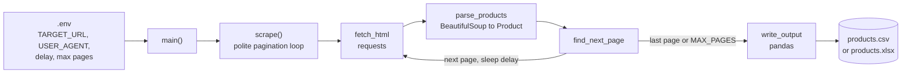

<div align="center">

# Fastwork Scraper Demo

**Clean product and price data from public listing pages, exported to CSV or Excel.**

     

</div>

<p align="center">
  
</p>

> **Status: portfolio demo (MVP).** It scrapes static HTML listing pages of a legal scraping sandbox, `books.toscrape.com`, to prove the pattern a client engagement would adapt. It is not a general crawler. Respect each site's terms and `robots.txt` before pointing it at any other target.

Last updated: 2026-11-03.

---

## Problem

Small businesses on freelance marketplaces ask for competitor price monitoring and product-list extraction delivered as spreadsheets. This repo shows the deliverable end to end (fetch, parse, paginate, export) in a small, tested codebase, against a target that is explicitly built for scraping practice.

## Design principles

| Principle | In the code |
|---|---|
| Three separate concerns | `fetch_html` (network only), `parse_products` (HTML to objects), `find_next_page` (pagination), each testable alone. |
| Never crash on bad markup | `parse_products` skips malformed cards and never raises; a fixture contains a deliberately broken card. |
| Polite by default | Fixed delay between pages (`SCRAPE_DELAY_SECONDS`, default 2), custom `USER_AGENT`, hard page cap (`MAX_PAGES`, default 5). |
| Fail soft on network errors | `scrape` logs the error and stops the loop, keeping what it already collected. |
| Only `main()` reads env vars | Library functions are importable from tests with no side effects. |
| Legal first | ADR 0001 documents why the demo does not target Shopee/Lazada and requires checking `robots.txt` before quoting any job. |

---

## Repository layout

```
fastwork-scraper-demo/
├── src/scraper.py                 fetch / parse / paginate / write + main()
├── tests/
│   ├── test_scraper.py            9 tests, no live network
│   └── fixtures/listing.html      saved page incl. a malformed card
├── examples/
│   ├── sample.csv                 sample output (books.toscrape.com)
│   └── README.md                  how to regenerate it
├── docs/
│   ├── decisions/0001-target-choice.md   ADR: why books.toscrape.com
│   └── progress/2026-07-21-scraper-mvp.md
├── .env.example                   configuration template
├── pyproject.toml
└── LICENSE
```

---

## Tech stack

| Area | Choice |
|---|---|
| Language | Python >= 3.11 |
| HTTP | `requests` >= 2.32 (uses `apparent_encoding` to avoid mojibake) |
| Parsing | `beautifulsoup4` >= 4.12 with `html.parser` |
| Export | `pandas` >= 2.2 (CSV with `utf-8-sig`, or Excel) |
| Config | `python-dotenv` >= 1.0 |
| Dev | `pytest` >= 8.0, `ruff` >= 0.6 (line length 100) |

Excel output relies on pandas' `to_excel`; an Excel writer engine such as `openpyxl` is not listed in `pyproject.toml` (assumption: you may need to install one for `OUTPUT_FORMAT=excel`; this was not verified).

---

## System architecture



## Flow: one scrape run

```mermaid
sequenceDiagram
    participant Main as main()
    participant Scr as scrape()
    participant Net as fetch_html
    participant Par as parse_products
    participant Pag as find_next_page
    participant Out as write_output
    Main->>Main: load .env, require TARGET_URL
    Main->>Scr: target, user agent, delay, max pages
    loop until no next page or max pages
        Scr->>Net: GET page
        alt HTTP or network error
            Net-->>Scr: RequestException
            Scr->>Scr: log error, stop loop
        else ok
            Net-->>Scr: HTML text
            Scr->>Par: parse cards
            Par-->>Scr: Product list (title, price, url, availability)
            Scr->>Pag: look for li.next a
            Pag-->>Scr: absolute next URL or None
            Scr->>Scr: sleep delay
        end
    end
    Scr-->>Main: collected products
    Main->>Out: write CSV or XLSX
    Out-->>Main: output path
```

Exit codes from `main()`: `0` success, `1` nothing scraped, `2` `TARGET_URL` missing. Output fields: `title`, `price`, `url`, `availability`.

---

## Configuration

Copy `.env.example` to `.env` and edit it. Variables read by `main()`:

| Variable | Default | Meaning |
|---|---|---|
| `TARGET_URL` | required | First listing page to scrape |
| `USER_AGENT` | `portfolio-demo-scraper/0.1` | HTTP User-Agent |
| `SCRAPE_DELAY_SECONDS` | `2` | Pause between pages |
| `MAX_PAGES` | `5` | Page cap |
| `OUTPUT_DIR` | `data/output` | Output folder |
| `OUTPUT_FORMAT` | `csv` | `csv`, or `excel` / `xlsx` |
| `LOG_LEVEL` | `INFO` | Logging level |

## Run and test

```bash
uv sync
cp .env.example .env             # then set TARGET_URL
uv run python src/scraper.py
uv run pytest
```

Note: the previous README mentions `pip install -r requirements.txt`, but no `requirements.txt` exists in this repo; dependencies are declared in `pyproject.toml`. The progress note also uses `uv run python -m src.scraper`.

## Testing

`tests/test_scraper.py` has 9 tests that run against `tests/fixtures/listing.html` with no network: card extraction, relative URL resolution, price and availability capture, skipping a malformed card, empty page, absolute next-page URL, last page returns `None`, CSV creation, and error on empty output. `fetch_html` and `scrape` (live network) are not covered by tests. The progress note (2026-07-21) records `9 passed` and a real run producing 60 rows; I did not re-run them.

## Sample output

`examples/sample.csv` is a real-run preview from `books.toscrape.com` (columns `title,price,url,availability`). Regenerate it with the steps in `examples/README.md`.

## Demo

- Walkthrough clip (60-90 s): not yet recorded (`TODO paste demo video link` in the previous README).
- Fastwork profile: not yet linked (`TODO` in the previous README).

## Security, ethics and limitations

- Only static HTML with the selectors for `books.toscrape.com` (`article.product_pod`, `li.next a`). A real target means changing selectors and pagination logic; JavaScript-rendered or anti-bot sites would need other tooling (ADR 0001).
- No retry or backoff: the loop stops on the first failed page (listed as next step in the progress note).
- Do not scrape sites whose terms prohibit it. ADR 0001 ranks Thai target types by legal cleanliness and says to run `curl <site>/robots.txt` before quoting a job.
- No secrets are required; `.env` only holds the target and tuning values and is gitignored via `.gitignore`.

## License

All Rights Reserved. See `LICENSE`.

## Contact

- Email: nattakamon@cloudnurse.co
- Response: within 1 business day (per the previous README)
