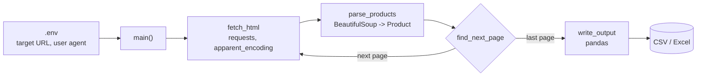

<div align="center">

# Fastwork Scraper Demo

**Clean product and price data from public pages, exported to CSV or Excel.**

   

</div>

> A portfolio demo that scrapes publicly available listing pages. Respect each site's terms and robots.txt before pointing it at a target.

## Tech stack

<p align="center">
  
</p>

## How it works



### Design

Three concerns stay separate so each is testable alone: `fetch_html` (network only), `parse_products` (HTML to objects, skips malformed cards, never raises) and `find_next_page` (pagination). Only `main()` reads environment variables.

---

Web scraper demo — clean product/price data from public sources exported to CSV/Excel.

## Demo
- Walkthrough clip (60–90s): TODO paste demo video link (YouTube unlisted recommended)
- Example output: `examples/sample.csv`

## Run in 3 commands
```bash
uv sync                         # or: pip install -r requirements.txt
cp .env.example .env            # then edit .env with your target URL
uv run python src/scraper.py
```

## What's inside
- `src/scraper.py` — the scraper
- `tests/` — pytest suite (run with `uv run pytest`)
- `examples/` — sample output the client can preview
- `demo/` — screenshots + clip link
- `docs/decisions/` — architectural decision records
- `docs/progress/` — session-by-session work log

## License
All Rights Reserved — see `LICENSE`.

## Contact
- Fastwork profile: TODO paste link once profile is live
- Email: nattakamon@cloudnurse.co
- Response: within 1 business day
